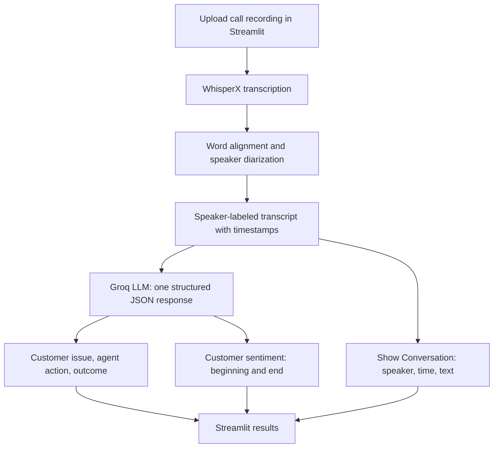

# Call Center Agent Performance Analysis

A Streamlit application that analyzes customer-service recordings using **WhisperX** for transcription and speaker diarization, and a **Groq LLM** for structured call summaries and text-based customer sentiment.

## How it works



## Features

- Upload a new recording (`WAV`, `MP3`, `M4A`, `FLAC`, or `OGG`) for automatic analysis.
- View a speaker-separated transcript with timestamps.
- See the **customer issue**, **agent action**, and **outcome / next step**.
- Compare text-based **customer sentiment at the beginning and end** of the call, with an explanation.
- Receive structured JSON output. No previous recordings are displayed in the interface.

## Getting started

**Requirements:** Windows with Python and FFmpeg installed; a CUDA-capable GPU is recommended. A Hugging Face token with access to [pyannote speaker diarization](https://huggingface.co/pyannote/speaker-diarization-community-1) and a Groq API key are required.

```powershell
python -m venv .venv
.\.venv\Scripts\Activate.ps1
pip install -r requirements.txt
Copy-Item .env.example .env
```

Set `HF_TOKEN` and `GROQ_API_KEY` in `.env`, then run:

```powershell
streamlit run app.py
```

The speech models load at application startup; model weights may be downloaded on the first launch. Upload a new call to begin processing. The resulting summary and conversation appear in the app.

## Evaluation

Previously recorded experiment results on **10 calls** from the [AppTek Call-Center Dialogues](https://huggingface.co/datasets/apptek-com/apptek_callcenter_dialogues) dataset (`diarization` configuration, `test` split; English, Australian). All 10 calls were processed successfully.

| Metric | Result |
|---|---:|
| Word Error Rate (WER) ↓ | 13.28% |
| Character Error Rate (CER) ↓ | 9.05% |
| Diarization Error Rate (DER) ↓ | 6.54% |
| Real-Time Factor (RTF) ↓ | 0.0576× |

Results are **pooled across the 10 calls**, taken from the saved experiment output (`results/apptek_eval/summary.json`); they are **not official AppTek benchmark scores**. Text normalization and diarization scoring settings can affect comparability. Summarization and sentiment have not been independently benchmarked against human annotations.

## Project layout

```text
app.py               Streamlit upload and results interface
src/main.py          Processing orchestration
src/pipeline.py      WhisperX transcription, alignment and diarization
src/llm.py           Groq prompt and structured JSON summary/sentiment
src/evaluation.py    Offline evaluation utilities
requirements.txt     Python dependencies
.env.example         Environment configuration template
```

## Limitations

- Speaker roles (Customer/Agent) are inferred from dialogue and may be incorrect.
- Customer sentiment is inferred from **transcribed words**, not voice tone.
- Transcription and diarization may be less accurate with overlap, background noise or unclear speech.
- Uploaded recordings and generated results are stored locally; use authorized audio only. Respect the dataset's licensing and redistribution conditions.
