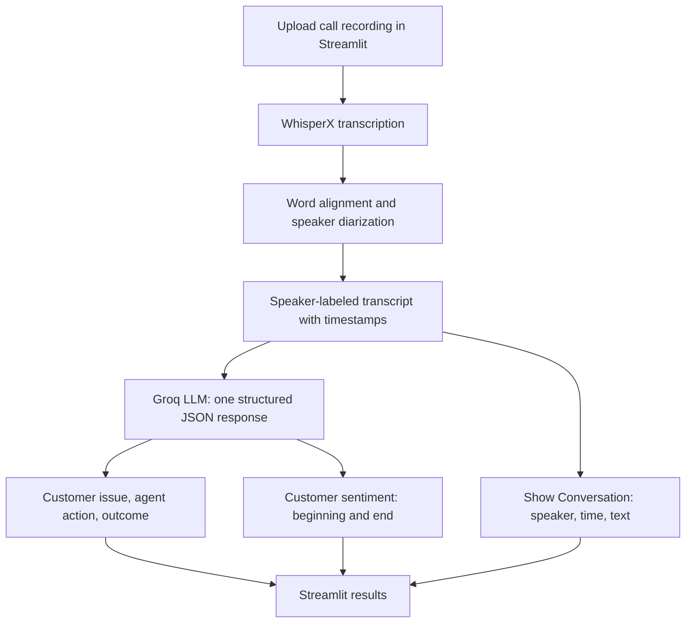

# Call Center Agent Performance Analysis

A Streamlit application that analyzes customer-service recordings using **WhisperX** for transcription and speaker diarization, and **GPT-OSS 20B through the Groq API** for structured call summaries and text-based customer sentiment.

## How it works



## Features

- Upload a new recording (`WAV`, `MP3`) for automatic analysis.
- View a speaker-separated transcript with timestamps.
- See the **customer issue**, **agent action**, and **outcome / next step**.
- Compare text-based **customer sentiment at the beginning and end** of the call, with an explanation.
- Receive structured JSON output. No previous recordings are displayed in the interface.

## Getting started

**Requirements:** Windows with Python and FFmpeg installed; a CUDA-capable GPU is recommended. A Hugging Face token with access to [pyannote speaker diarization](https://huggingface.co/pyannote/speaker-diarization-community-1) and a Groq API key are required.

```powershell
python -m venv .venv
.\.venv\Scripts\Activate.ps1
pip install -r requirements.txt
Copy-Item .env.example .env
```

Set `HF_TOKEN` and `GROQ_API_KEY` in `.env`, then run:

```powershell
streamlit run app.py
```

The speech models load at application startup; model weights may be downloaded on the first launch. Upload a new call to begin processing. The resulting summary and conversation appear in the app.

## Evaluation

The system was evaluated on **100 English customer-service calls** from the [AppTek Call-Center Dialogues](https://huggingface.co/datasets/apptek-com/apptek_callcenter_dialogues) dataset (`diarization` configuration, `test` split). The selected calls cover Australian English (`en_AU`, 58 calls) and Canadian English (`en_CA`, 42 calls), across several customer-service domains.

**WhisperX completed transcription and speaker diarization for all 100 calls**, with reference-based performance metrics:

| Metric | Pooled result |
|---|---:|
| Word Error Rate (WER) ↓ | **14.66%** |
| Character Error Rate (CER) ↓ | **9.92%** |
| Diarization Error Rate (DER) ↓ | **11.04%** |
| Real-Time Factor (RTF) ↓ | **0.1694×** |

WER and CER were pooled using the reference word and character counts, not averaged across calls. DER was pooled from diarization error components (`collar=0`, overlapping speech included, with an inferred evaluation region). WER/CER use lowercase and punctuation normalization; these are **project evaluation results, not official AppTek benchmark scores**. RTF is computed from total recorded processing time divided by total audio duration.

### LLM analysis completion

| Stage | Completed | Not completed |
|---|---:|---:|
| WhisperX transcription and diarization | **100 / 100** | 0 |
| GPT-OSS 20B call summary and customer sentiment | **89 / 100** | **11** |

 **11 calls still had pending LLM analysis** (call IDs **089–093 and 095–100**). Longer conversations required relatively large token requests; together with cumulative batch usage, the requests reached the **Groq daily token limit (200,000 tokens/day)** and returned HTTP **429** rate-limit responses. These 11 calls **still have WhisperX transcripts and WER/CER/DER/RTF metrics**; only their LLM summaries and sentiment analyses are incomplete. Their missing analyses are not counted as completed results.

The evaluation produces `results/call_evaluation.xlsx`, with one row per call, including the source audio link, WhisperX transcript, reference transcript, available summary/sentiment, performance metrics, and completion status. The batch can be rerun with cached transcripts to retry pending LLM analyses:

```powershell
python -m src.main evaluate --limit 100 --reuse
```

Summarization and sentiment quality have not been independently scored against human-annotated references.

## Project layout

```text
app.py                      Streamlit upload and results interface
src/main.py                 Processing orchestration
src/pipeline.py             WhisperX transcription, alignment and diarization
src/llm.py                  Groq prompt and structured JSON summary/sentiment
src/evaluation.py           Offline evaluation, per-call metrics and Excel export
doc/call_evaluation.xlsx    Per-call transcripts, summaries, sentiment and evaluation metrics for 100 calls
doc/CallCenter_DataSet.xlsx Research survey
doc/Presentation.pptx       Project presentation
requirements.txt            Python dependencies
.env.example                Environment configuration template
```

## Limitations

- Speaker roles (Customer/Agent) are inferred from dialogue and may be incorrect.
- Customer sentiment is inferred from **transcribed words**, not voice tone.
- The LLM batch analysis is subject to Groq token-rate limits on long calls and large batches.
- Transcription and diarization may be less accurate with overlap, background noise or unclear speech.